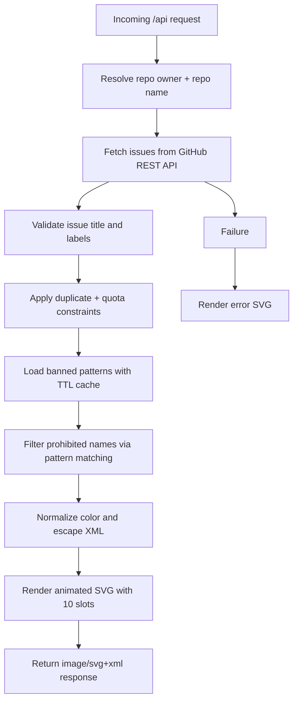

<div align="center">

<pre>
  ______ _____ _______ _     _ _     _ ______       _____ _______ _______ _     _ _______ _______
 |  ____   |      |    |_____| |     | |_____]        |   |______ |______ |     | |______ |______
 |_____| __|__    |    |     | |_____| |_____]      __|__ ______| ______| |_____| |______ ______|
                                                                                                 
 _     _ _______  ______  _____  _______ _______      ______  _______ ______   ______ _______    
 |_____| |______ |_____/ |     | |______ |______      |_____] |_____| |     \ |  ____ |______    
 |     | |______ |    \_ |_____| |______ ______|      |_____] |     | |_____/ |_____| |______    
                                                                                                 
</pre>

A serverless logging-style visualization library that converts validated GitHub issue activity into a live animated SVG badge for README dashboards and community telemetry.

[](LICENSE)
[](https://nodejs.org/)
[](https://vercel.com/)
[](https://docs.github.com/en/rest/issues/issues)

## Example in Markdown:

[](https://github.com/OstinUA)

</div>

## Table of Contents

- [Features](#features)
- [Tech Stack & Architecture](#tech-stack--architecture)
- [Getting Started](#getting-started)
- [Testing](#testing)
- [Deployment](#deployment)
- [Live Endpoints](#live-endpoints)
- [Usage](#usage)
- [Configuration](#configuration)
- [License](#license)
- [Support the Project](#support-the-project)

## Features

- Serverless SVG generation endpoint that renders an animated “heroes board” from GitHub issues.
- Strict issue-title parsing via a structured contract: `<HeroeName | display_name | #hexcolor>`.
- Label-based admission control (`Valid` label required).
- Duplicate and abuse prevention:
  - Max 2 accepted issues per GitHub account.
  - Case-insensitive de-duplication of displayed names.
  - Title-length ceiling for predictable payload quality.
- Runtime profanity and abuse filtering via remote banned-pattern dictionaries.
- Pattern engine with wildcard and composition support (`*`, `+`, `&&`) for flexible moderation rules.
- In-memory TTL caching for banned word lists to reduce outbound API load and latency.
- Defensive SVG safety controls:
  - XML escaping for dynamic text.
  - Hex color validation and fallback palette strategy.
- Operationally friendly defaults:
  - Token auto-detection from `GH_TOKEN` / `GITHUB_TOKEN`, tolerant of pasted whitespace and quotes.
  - Anonymous retry when GitHub rejects the configured token, so one bad secret cannot blank every README.
  - No-token mode for public repositories (rate-limit tradeoff).
- JSON health endpoint (`/api/health`) reporting token, quota, dictionary and entry state with a monitor-friendly status code.
- Error-mode SVG output instead of plain JSON errors, preserving badge embedding behavior.

> [!IMPORTANT]
> This project fetches data from GitHub APIs at request time. For production-grade reliability and higher request quotas, configure a GitHub token.

## Tech Stack & Architecture

### Core Stack

- **Runtime:** Node.js (serverless target)
- **Platform:** Vercel Serverless Functions
- **Language:** JavaScript (ES Modules)
- **Data Source:** GitHub REST API (issues + git trees/raw content)
- **Output Format:** SVG + inline CSS animations

### Project Structure

```text
.
├── api/
│   ├── index.js                 # Serverless entry point: request handling and response headers
│   └── health.js                # JSON diagnostics for the deployment (`/api/health`)
├── lib/
│   ├── badge-svg.js             # SVG layout, animation timings and the error badge
│   ├── dictionaries.js          # Remote dictionary loading, TTL cache, single-flight
│   ├── entries.js               # Admission rules: labels, quotas, de-duplication, moderation
│   ├── github.js                # GitHub REST client: timeouts, headers, typed errors
│   ├── health.js                # Health report assembled from the same data as the badge
│   ├── issue-title.js           # The `<HeroeName|Name|#RRGGBB>` contract
│   ├── patterns.js              # Wildcard matcher (`*`, `+`, `&&`) without backtracking
│   ├── query.js                 # `?user=&repo=` parsing shared by both endpoints
│   └── xml.js                   # XML escaping for user-supplied text
├── docs/                        # Static validator page (GitHub Pages and the deployment root)
├── scripts/
│   └── dev-server.mjs           # Dependency-free local runtime (`npm run dev`)
├── test/                        # Unit tests for the parsing, matching and rendering layers
├── banned-words/                # Local word lists (reference/data assets)
├── trigger action/              # Workflow automation for AI-assisted issue reports
├── vercel.json                  # Routes: `/`, `/badge`, `/health` and the two functions
├── LICENSE
├── package.json
└── README.md
```

### Key Design Decisions

- **Two small serverless handlers** — the badge and its health report — keep deployment simple and platform-portable.
- **Validation-first ingestion pipeline** ensures only syntactically valid and moderated entries become visible.
- **Fail-soft moderation data loading** uses caching and graceful degradation when external resources fail.
- **Presentation stability by padding to 10 rows** keeps badge dimensions and layout deterministic.
- **SVG as transport format** makes the badge embeddable in Markdown, docs, and profile READMEs.



> [!TIP]
> Treat this endpoint as a read-optimized telemetry surface, not as a persistence layer. All state is computed per request.

## Getting Started

### Prerequisites

- Node.js `>=18`
- npm `>=9`
- A GitHub repository with issues enabled
- (Recommended) GitHub token for higher API rate limits
- (Optional) Vercel account for hosted deployment

### Installation

```bash
git clone https://github.com/<your-org>/Issues-heroes-badge.git
cd Issues-heroes-badge
npm install
```

> [!NOTE]
> If you only use this locally for development and testing with public repositories, a token is optional, but rate limits may be reached quickly.

## Testing

The badge pipeline is covered by unit tests that run on the Node.js built-in test
runner — no extra dependencies are required.

```bash
npm ci
npm test
```

The suite exercises the issue-title grammar, the pattern engine (including
adversarial input), admission rules, SVG escaping, credential handling and the
health report. CI runs the same command for every pull request.

For a local end-to-end check, run the built-in dev server — it serves the same
routes as the deployment and needs no Vercel account:

```bash
npm run dev
curl "http://localhost:3000/api?user=readme-SVG&repo=Issues-heroes-badge"
curl -s "http://localhost:3000/api/health"
```

If you prefer the real runtime, the Vercel CLI works too (it also reads `.env` /
`.env.local`, so a local `GITHUB_TOKEN` exercises the authenticated path):

```bash
npx vercel dev
curl "http://localhost:3000/api?user=readme-SVG&repo=Issues-heroes-badge"
curl -s "http://localhost:3000/api/health" | jq
```

## Deployment

### Vercel Deployment (Recommended)

1. Push this repository to GitHub.
2. Import it into Vercel as a new project.
3. Configure environment variables (`GITHUB_TOKEN` recommended).
4. Deploy to Production.
5. Verify the deployment before embedding the badge anywhere:

```bash
curl -s https://issues-heroes-badge-zeta.vercel.app/api/health | jq '{ok, degraded, errors}'
```

Routing lives in [`vercel.json`](vercel.json): the root path serves the validator
page, `/badge` and `/health` are short aliases of the two functions, and no build
step is required. The production deployment of this repository is
**<https://issues-heroes-badge-zeta.vercel.app>**; if you fork it, Vercel assigns
your own domain and only this file plus the README need to change.

### Suggested CI/CD Integration

- Trigger deploys on `main` branch pushes.
- Add a pre-deploy stage with:
  - `npm ci`
  - `npm test`
- Include a synthetic health check hitting `/api/health` post-deployment: it returns
  `503` when the badge cannot be rendered, so no JSON parsing is needed to alarm.

### Containerization Note

This project is optimized for serverless delivery. If containerized, wrap the handler with a compatible Node HTTP adapter and ensure outbound access to GitHub APIs.

## Live Endpoints

Base URL: **<https://issues-heroes-badge-zeta.vercel.app>**

| Route | Response | Purpose |
| --- | --- | --- |
| `/api` | `image/svg+xml` | The badge; accepts `?user=` and `?repo=`. |
| `/badge` | `image/svg+xml` | Alias of `/api` for short embeds. |
| `/api/health` | `application/json` | Deployment diagnostics, `200` when healthy and `503` when not. |
| `/health` | `application/json` | Alias of `/api/health`. |
| `/` | `text/html` | Issue-title validator, also served by GitHub Pages. |

The health report answers the two questions a broken badge cannot: is the function
reaching GitHub with the credential it was given, and did the moderation
dictionaries load? It reports *whether* a token is configured and which variable
supplied it — never the value:

```bash
curl -s https://issues-heroes-badge-zeta.vercel.app/api/health | jq
```

```json
{
  "ok": true,
  "degraded": false,
  "github": {
    "ok": true,
    "token": { "configured": true, "source": "GITHUB_TOKEN" },
    "rateLimit": { "limit": 5000, "remaining": 4990, "authenticated": true }
  },
  "dictionaries": { "ok": true, "source": "readme-SVG/Banned-words@main", "patterns": 4210 },
  "issues": { "ok": true, "fetched": 57, "accepted": 6, "slots": 10 }
}
```

`degraded: true` means the badge still renders but moderation fell back to an empty
pattern index, usually because `readme-SVG/Banned-words` was unreachable.

## Usage

### Markdown Badge Embed

```md

```

For your own deployment, swap the domain and the target repository:

```md

```

### Example Issue Contract

Create issues whose title follows this exact format:

```text
<HeroeName|CyberKnight|#3f88e6>
```
```text
<HeroeName|CyberKnight>
```

And ensure the issue contains the `Valid` label.

### Endpoint Behavior Overview

```js
// Request example
// GET /api?user=octocat&repo=Hello-World

// High-level behavior:
// 1) Pull issues from GitHub
// 2) Validate title format and "Valid" label
// 3) Reject banned or duplicate names
// 4) Render animated SVG response
```

> [!CAUTION]
> User-provided names are rendered into SVG text nodes. The library escapes XML-sensitive characters, but you should still enforce moderation policies in your issue workflow.

## Configuration

### Environment Variables

| Variable | Required | Default | Description |
| --- | --- | --- | --- |
| `GH_TOKEN` | No* | unset | Preferred token variable when both are set. |
| `GITHUB_TOKEN` | No* | unset | GitHub token used for authenticated API calls. |
| `BANNED_WORDS_REPO` | No | `readme-SVG/Banned-words` | Source repository for banned-word dictionaries. |
| `BANNED_WORDS_BRANCH` | No | `main` | Branch used when reading moderation dictionaries. |

\* Required for production-grade quota and private repository access.

> [!NOTE]
> Token values are trimmed and unquoted before use, so a secret pasted with a
> trailing newline or wrapped in quotes still works. If GitHub rejects the token
> with `401`, the request is repeated anonymously — a lower quota, but the badge
> keeps rendering — and the fallback is written to the function log.
> `/api/health` shows which of the two happened: `github.rateLimit.authenticated`
> is `true` only when the deployment is really running on a token.

### Runtime Query Parameters

| Parameter | Required | Default | Description |
| --- | --- | --- | --- |
| `user` | No | `readme-SVG` | GitHub owner/user/organization name. |
| `repo` | No | `Issues-heroes-badge` | Target repository to inspect issues from. |

Both endpoints read these parameters through the same validator: anything that is
not shaped like a GitHub identifier (including a repeated `?user=a&user=b`) falls
back to the default instead of being interpolated into a request path.

### Configuration Strategy

1. Start with defaults for public repositories.
2. Add `GITHUB_TOKEN` in deployment secrets (a fine-grained token with **public
   repositories read-only** access is enough; no scope is needed for public data).
3. Confirm the token is picked up: `curl -s <deployment>/api/health | jq .github`.
4. Override moderation source via `BANNED_WORDS_REPO` if you maintain custom dictionaries.
5. Keep issue template and labels standardized to protect pipeline quality.

## License

This project is released under the **MIT License**. See [`LICENSE`](LICENSE) for full terms.

## Support the Project

[](https://www.patreon.com/OstinFCT)
[](https://ko-fi.com/fctostin)
[](https://boosty.to/ostinfct)
[](https://www.youtube.com/@FCT-Ostin)
[](https://t.me/FCTostin)

If you find this tool useful, consider leaving a star on GitHub or supporting the author directly.
